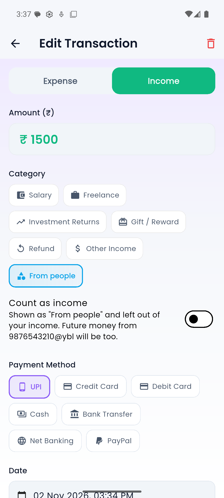
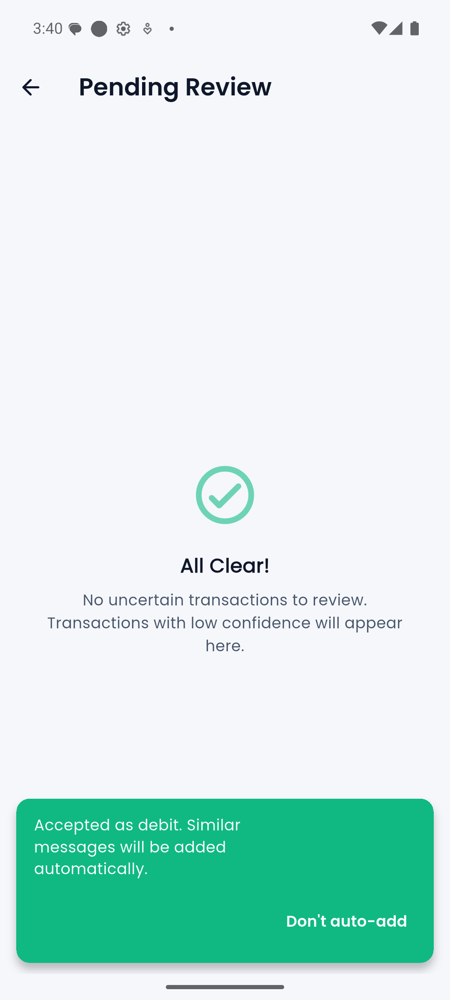
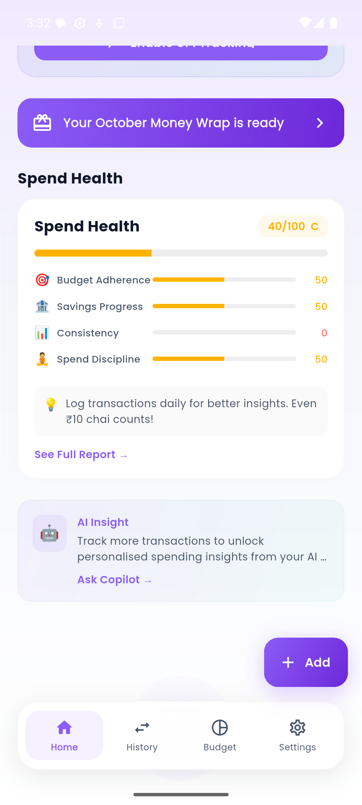
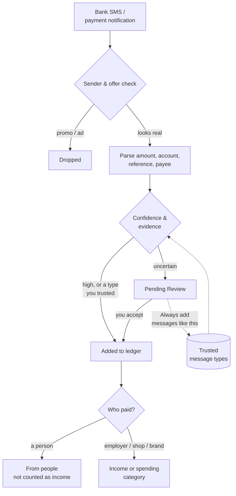

<div align="center">


# P.E.T — Personal Expense Tracker

**Your bank SMS, turned into a budget. Automatically, privately, on your phone.**

An Android expense tracker for India that reads UPI and bank alerts on-device,
tells real payments from look-alike ads, and keeps money from friends separate from your income.

[](https://github.com/psuvraneel-cyber/Personal-Expense-Tracker/actions/workflows/ci.yml)
[](https://github.com/psuvraneel-cyber/Personal-Expense-Tracker/actions/workflows/codeql.yml)


[Features](#-features) · [How SMS tracking works](#-how-sms-tracking-works) · [Privacy](#-privacy-by-design) · [Tech stack](#%EF%B8%8F-tech-stack) · [Getting started](#-getting-started) · [Testing](#-testing)

</div>

---

## 📱 Screenshots

<div align="center">

| "From people" & Count as income | Pending Review that learns | Spend Health score |
|:---:|:---:|:---:|
|  |  |  |

<sub>Screenshots use test data on an Android emulator.</sub>

</div>

---

## ✨ Features

### 💸 Automatic tracking
- **UPI & bank SMS** are read and parsed **on the phone**. No bank login, no screen scraping.
- **Notification listener** catches payment-app alerts too, with cross-source de-duplication so one payment is never counted twice.
- **Real alert or ad?** Sender headers (TRAI `XX-BANK-S/T/P` format) plus an evidence check (account ending, reference number, balance) keep "Get ₹500 cashback!" promos out of your ledger.
- **Who did you pay?** An on-device classifier sorts the other party into **company, shop or person**, using brand lists, trade words ("Kirana", "Medicals"), merchant QR handles and name shape.
- **Pending Review** for anything uncertain. Accept once and P.E.T **adds messages like it automatically**, with an undo and a list in Settings.

### 🧾 Money that's really yours
- **"From people":** money a friend or relative sends you is tracked but **kept out of income**, health scores and forecasts.
- **One-tap "Count as income"** for the exceptions (rent from a tenant, say); P.E.T remembers it for that payer.
- **Salary detection**, refunds, recurring bills and credit-card bill payments handled separately from spending.

### 📊 Plan and understand
- Category **budgets** and alerts, **savings goals**, **weekly planner** and **Focus Mode** (pause spending in chosen categories).
- **Cash-flow forecast**, **Spend Health** score and a monthly **Money Wrap** recap.
- **Recurring bill detection** with reminders, **tax buckets**, and shared **household budgets**.
- **AI Copilot** for questions about your spending (sent as aggregates only; see [Privacy](#-privacy-by-design)).

### 🔐 Everyday comfort
- Encrypted local database, **biometric lock**, hidden amounts in notifications.
- **Offline first** with optional Google sign-in and cloud backup.
- **PDF & CSV export**, home-screen widget, English and Hindi UI.

---

## 🧠 How SMS tracking works



Everything in this diagram runs **on the device**. Transfers between your own accounts and card-bill payments always go to review, because counting them would double your spending.

---

## 🛡 Privacy by design

| | |
|---|---|
| **SMS never leaves the phone** | Messages are parsed locally. Only the extracted amount, payee, date and category are stored, and backed up only if you sign in. |
| **Personal messages ignored** | Messages from personal numbers or without a payment amount are discarded immediately. |
| **Masked & time-limited** | Account, card and phone numbers are masked; stored message text is deleted after 90 days. |
| **Encrypted at rest** | Local data lives in an SQLCipher database; keys in Android secure storage. |
| **AI sees totals, not transactions** | The Copilot receives aggregates (top categories, budget, totals) through a Cloudflare Worker that verifies Firebase ID tokens. No API keys ship in the app. |
| **Delete anytime** | In-app account deletion wipes cloud and local data. |

Read the full [Privacy Policy](https://personal-expense-tracker-6891b.web.app/privacy-policy.html) · [Terms](https://personal-expense-tracker-6891b.web.app/terms.html) · [Account deletion](https://personal-expense-tracker-6891b.web.app/account-deletion.html)

---

## 🛠️ Tech stack

| Layer | Technology |
|---|---|
| App | Flutter 3.41 · Dart 3.11 · Provider |
| Local data | SQLCipher (`sqflite_sqlcipher`), WorkManager background scans |
| Android native | Kotlin: SMS receiver, notification listener, encrypted notification cache, home widget |
| Cloud | Firebase Auth, Cloud Firestore (with security-rules tests), Crashlytics, Analytics, Remote Config, App Check |
| AI Copilot | Cloudflare Worker + Durable Object rate limiting → Groq (`openai/gpt-oss-120b`, set server-side) |
| Payments | RevenueCat (Google Play Billing) |
| Charts & UI | `fl_chart`, `flutter_animate`, Poppins |

<details>
<summary><b>📂 Project structure</b></summary>

```text
lib/
├── core/            theme, widgets, constants, utilities
├── data/            models, SQLCipher database & migrations, repositories
├── providers/       app state (Provider)
├── screens/         dashboard, history, budgets, settings, SMS & review screens
├── services/        SMS ingestion pipeline, parsers, classifiers, sync, export
├── premium/         goals, forecasts, alerts, Copilot, household, planner
└── l10n/            English & Hindi strings
android/             Kotlin SMS receiver, notification listener, widget
cloudflare_worker/   AI Copilot proxy (JavaScript) + tests
firestore_tests/     Firestore security-rules tests (emulator)
test/                110+ Dart test files
docs/                legal pages (Firebase Hosting) & operations runbook
```

</details>

---

## 🚀 Getting started

### Prerequisites
- [Flutter SDK](https://docs.flutter.dev/get-started/install) 3.41+ (Dart 3.11)
- Android Studio or the Android SDK, JDK 17
- A Firebase project ([FlutterFire CLI](https://firebase.google.com/docs/flutter/setup))
- Optional: Node 22 and [Wrangler](https://developers.cloudflare.com/workers/wrangler/) for the AI Worker

### 1. Clone and install
```bash
git clone https://github.com/psuvraneel-cyber/Personal-Expense-Tracker.git
cd Personal-Expense-Tracker
flutter pub get
```

### 2. Connect Firebase
```bash
dart pub global activate flutterfire_cli
flutterfire configure --project=<your-firebase-project-id>
```
This writes `lib/firebase_options.dart` and `android/app/google-services.json`. Both are git-ignored; **never commit them**. See `lib/firebase_options.example.dart` for the expected shape.

### 3. Add environment values
```bash
cp .env.example .env   # then fill in your RevenueCat public SDK keys
```

### 4. Run
```bash
flutter run --dart-define-from-file=.env
```
On the first screen, **Sign in as Guest** keeps everything on the device; **Continue with Google** turns on cloud backup.

<details>
<summary><b>Optional: deploy the AI Copilot Worker</b></summary>

```bash
cd cloudflare_worker
npm install
npx wrangler secret put GROQ_API_KEY
npx wrangler deploy
```
Then point `WorkerApi.baseUrl` in `lib/services/worker_api.dart` at your Worker. The model is chosen in `wrangler.toml` (`GROQ_MODEL`), so it can change without an app update.

</details>

---

## 🧪 Testing

```bash
flutter analyze
flutter test                                  # Dart unit & widget tests
cd android && ./gradlew :app:testDebugUnitTest # Kotlin unit tests
cd cloudflare_worker && npm test               # Worker tests
cd firestore_tests && npm test                 # Firestore rules (needs the emulator)
```

Every pull request runs formatting, analysis, all of the above and CodeQL in [GitHub Actions](https://github.com/psuvraneel-cyber/Personal-Expense-Tracker/actions).

---

## 🗺️ Status

P.E.T is in **pre-release**, preparing for Google Play. Track progress in [Releases](https://github.com/psuvraneel-cyber/Personal-Expense-Tracker/releases) and [Pull requests](https://github.com/psuvraneel-cyber/Personal-Expense-Tracker/pulls?q=is%3Apr).

Found a bug or have an idea? [Open an issue](https://github.com/psuvraneel-cyber/Personal-Expense-Tracker/issues). It's the best way to get in touch.

---

## 📄 License

Copyright © 2026 [psuvraneel-cyber](https://github.com/psuvraneel-cyber). **All rights reserved.**

The source is public so you can read and learn from it, but it is not licensed for reuse, redistribution or commercial use. Please open an issue to ask about anything beyond that.

<div align="center">
<sub>Built with Flutter in India 🇮🇳 · If you find it interesting, a ⭐ helps others discover it.</sub>
</div>
