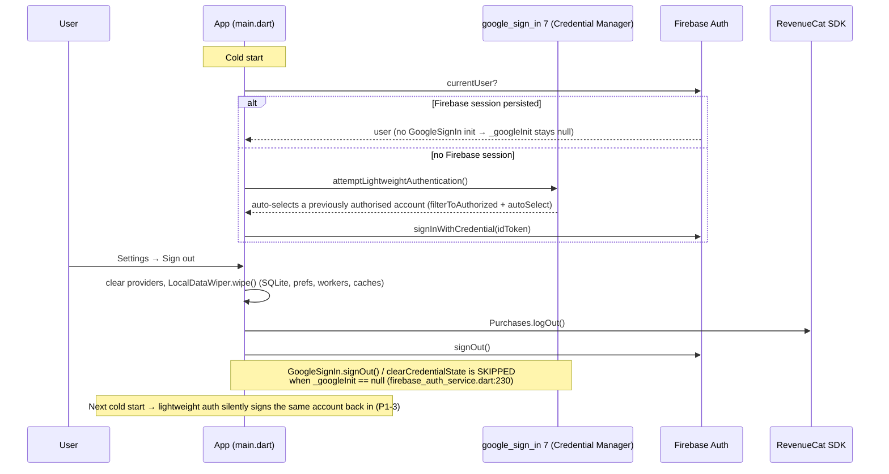
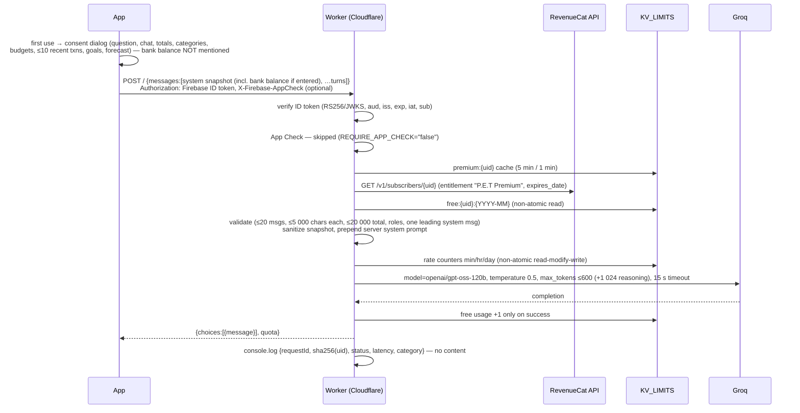

# P.E.T — Security Architecture & Sensitive Data Flow

**Audit date:** 1 November 2026
**Code audited:** `main` @ `daaa1b1adbe5b386f58b0080413d20029d944577` (2026-10-13). The local copy in `C:\Personal-Expense-Tracker-main` has the same 491 files and content, with CRLF line endings. It is not a Git checkout.
**App:** `com.pet.tracker.pet` 1.0.1 (versionCode 13), SQLite schema v22
**Companion documents:** `PLAY_STORE_AUDIT_REPORT.md` (findings referenced as `P0-x`, `P1-x`, …), `PLAY_STORE_TEST_MATRIX.md`, `PLAY_STORE_RELEASE_CHECKLIST.md`

Everything below is derived from the source code unless marked **[deployed]**, meaning it was observed on a live endpoint on the audit date, or **[external]**, meaning it can't be verified from the repository.

---

## 1. Trust boundaries

```mermaid
flowchart LR
  subgraph Device["Android device (trust boundary 1: app sandbox)"]
    direction TB
    SMSP[(System SMS provider<br/>content://sms/inbox)]
    NLS[TransactionNotificationListener<br/>allow-listed packages only]
    RCV[SmsBroadcastReceiver<br/>BROADCAST_SMS-protected]
    ENC[(EncryptedNotificationCache<br/>EncryptedSharedPreferences AES-256-GCM)]
    subgraph Flutter["Flutter (UI isolate + WorkManager isolates)"]
      ING[FinancialIngestionService<br/>parse · classify · dedup · minimise]
      PROV[Providers / UI]
      SYNCQ[transaction_sync_queue]
      AIC[AiCopilotService]
    end
    DB[(SQLCipher DB<br/>app_flutter/pet_tracker.db)]
    KS[(flutter_secure_storage<br/>Keystore-wrapped key + bank balance)]
    FSC[(Firestore SDK cache<br/>databases/firestore.* — PLAINTEXT)]
    PREFS[(SharedPreferences<br/>settings, premium cache, widget amounts)]
  end

  subgraph Google["Google Cloud (trust boundary 2)"]
    AUTH[Firebase Auth]
    FS[(Cloud Firestore<br/>users/{uid}/…, households/…)]
    APPCHK[App Check / Play Integrity]
    CRASH[Crashlytics — on by default]
    GA[Analytics — opt-in]
    RCFG[Remote Config]
    HOST[Firebase Hosting — privacy policy, deletion page<br/>**[deployed] currently 'Site Not Found'**]
  end

  subgraph CF["Cloudflare (trust boundary 3)"]
    WK[Worker pet-ai-copilot<br/>verifies Firebase ID token<br/>App Check NOT enforced]
    KV[(KV_LIMITS<br/>quotas · referral · deletion requests)]
  end

  GROQ[Groq LLM API<br/>openai/gpt-oss-120b]
  RC[RevenueCat]
  PLAY[Google Play Billing]

  SMSP -->|READ_SMS, main thread| ING
  RCV -->|live EventSink or expedited WorkManager scan| ING
  NLS --> ENC --> ING
  NLS -->|live EventSink| ING
  ING --> DB
  ING --> SYNCQ
  PROV <--> DB
  KS -. key .-> DB
  SYNCQ -->|HTTPS| FS
  PROV <-->|snapshot listeners| FS
  FS -. local copy .-> FSC
  PROV --> AUTH
  AIC -->|ID token + App Check token + financial snapshot| WK
  WK --> KV
  WK -->|snapshot + chat| GROQ
  WK -->|secret key: entitlement check, promo grants| RC
  PROV -->|public SDK key| RC
  RC <--> PLAY
  PROV --> CRASH
  PROV -. only if opted in .-> GA
```

### Boundary-by-boundary assessment

| Boundary | Control in code | Verdict |
|---|---|---|
| Other apps → SMS receiver | Static receiver guarded by `android.permission.BROADCAST_SMS` (`AndroidManifest.xml:102-109`) | ✅ Correct |
| Other apps → notification listener | Guarded by `BIND_NOTIFICATION_LISTENER_SERVICE`. The user must grant access in system settings. | ✅ Correct |
| Personal SMS → app | Native pre-filter drops numeric senders and messages without a currency amount (`SmsReaderPlugin.kt:142-156`). Rejected messages keep only hash, sender and timestamps (`financial_ingestion_service.dart:1235-1260`). | ✅ Text minimised (the sender ID of rejected messages is still kept) |
| Personal app notifications → app | Explicit package allow-list (`TransactionNotificationListener.kt:110-147`). Messaging apps are excluded. | ⚠️ The list includes shopping and telecom super-apps (Amazon Shopping, Tata Neu, Airtel Thanks) (**P3-4**) |
| Device → Firestore | Firebase Auth. Rules restrict `users/{uid}/**` to `request.auth.uid == uid`. | ✅ Isolation correct. ⚠️ No schema or size validation on most paths (**P2-1**) |
| Device → Worker | Worker verifies RS256 signature, `kid`, `exp`, `iat`, `aud`, `iss` and `sub` against Google JWKS (`index.js:30-130`) | ✅ Correct. ⚠️ App Check is not enforced (`wrangler.toml:12`) (**P2-2**) |
| Worker → Groq / RevenueCat | Secrets live in Worker secrets only. Model, temperature, system prompt and token caps are server-controlled. | ✅ Correct |
| Client entitlement → server features | AI is checked server-side against RevenueCat. Household creation is client-only (**P2-1**). Local premium screens are client-only by nature. | ⚠️ Partial |

---

## 2. Authentication & session



* **Identity providers:** Google Sign-In; Firebase anonymous auth (the "guest" option); and a local-only guest with the fixed ID `guest_user` as a fallback.
* **Session isolation:** the local SQLite database is single-tenant: user data tables have no `userId` column. Isolation therefore depends entirely on `LocalDataWiper.wipe()` running at sign-out (`local_data_wiper.dart:47-77`). Each wipe step swallows its own errors, so a failed `wipeAllUserData` does not stop the sign-out.
* **Async isolation:** `FirestoreSyncService.currentSession` (uid + generation) guards snapshot handlers and the sync queue (`transaction_provider.dart:268-473, 1053-1150`). Queue rows carry a `userId` and are filtered by it (`transaction_repository.dart:287-297`).
* **Account deletion:** see section 7.

---

## 3. Local data protection

| Store | Location | Protection | Notes |
|---|---|---|---|
| Main ledger (transactions, budgets, goals, observations, queue, …) | `/data/data/com.pet.tracker.pet/app_flutter/pet_tracker.db` (+ `-wal`, `-shm`) | SQLCipher. 256-bit random key (`Random.secure`) held in `flutter_secure_storage` (Keystore-wrapped). `resetOnError: false`. A missing key raises `DatabaseKeyUnavailableException`, and the app shows an explicit recovery screen with no silent regeneration. | ✅ Key handling is sound. ⚠️ Falls back silently to a **plaintext** DB if `isSqlCipherSupported()` returns false (`database_helper.dart:118-149`) (**P3-7**) |
| Firestore offline cache | `/data/data/…/databases/firestore.*` | **None** (SDK default persistence) | ⚠️ A plaintext copy of every synced document. Not cleared on sign-out because `clearPersistence()` is never called (**P2-8**) |
| Pending notifications | `shared_prefs/pet_notification_cache_v2.xml` | EncryptedSharedPreferences (AES-256-SIV keys, AES-256-GCM values). Never falls back to plaintext: a RAM-only queue of up to 200 items is used instead. | ✅ ⚠️ Deprecated alpha library, with no TTL or size cap on persisted items (**P3-8**) |
| Bank balance (cash-flow anchor) | `flutter_secure_storage` | Keystore-wrapped | ✅ At rest. ❌ **Sent to the AI Worker** despite the policy saying it is "never uploaded" (**P1-1a**) |
| Display name / email | `flutter_secure_storage` | Keystore-wrapped | ✅ |
| Premium cache, tax settings, consent flags | SharedPreferences | Plaintext | Acceptable (non-sensitive), but `pet_cached_premium` is editable on rooted devices: it unlocks only the client-side premium screens |
| Widget numbers | `HomeWidgetPreferences` | Plaintext | Not written while biometric lock is on (per the design comment) |
| WorkManager | `databases/androidx.work.workdb` | Plaintext | Task names only |

### Backup and device-to-device (D2D) transfer — P2-7

`android:allowBackup="false"` disables cloud backup. On Android 12+, however, D2D transfer is governed only by `dataExtractionRules`. Both rule files exclude `domain="database" path="pet_tracker.db*"`, which is `/data/data/<pkg>/databases/pet_tracker.db`. The real database is at `app_flutter/pet_tracker.db` (`path_provider_android 2.3.1` → `getDir("flutter")`, which is the `root` domain). As a result:

* The encrypted DB **and** the secure-storage prefs file are transferred. The Keystore key that unwraps them is not, so the new phone shows the "database recovery" screen on first launch.
* The **plaintext** Firestore cache in `databases/` is transferred as well.
* The privacy policy (§4) states that the database is excluded from D2D transfer. That is incorrect.

---

## 4. SMS processing pipeline

```mermaid
flowchart TB
  A[SMS_RECEIVED broadcast] -->|reassemble multipart per sender<br/>timestamp = receive time| B{isLikelyBankSms?<br/>non-numeric sender AND currency+digit<br/>AND (bank sender OR txn keyword)}
  B -- no --> X[dropped in native code, never reaches Dart]
  B -- yes, app running --> C[EventSink → Dart]
  B -- yes, app not running --> D[expedited WorkManager inbox scan<br/>+ 15-min periodic scan, 6-h reconciliation]
  C --> E[FinancialIngestionService.ingestMessage<br/>(serialized)]
  D --> E
  E --> F{observationHash seen?<br/>or tombstoned in sms_processing_state}
  F -- yes --> X2[skip]
  F -- no --> G[ClassificationRuleEngine.classify]
  G -- null --> R[financial_observations: state=rejected<br/>body/text BLANKED, hash + sender kept]
  G -- bill statement --> BILL[recurring_payments upsert]
  G -- balance only --> BAL[linked_accounts observed balance]
  G -- transaction --> H[fingerprint = sha256(ref|acct|upi|merchant + amount + 15-min bucket or day)]
  H --> I{fingerprint already in transactions?}
  I -- yes --> L[observation state=linked (duplicate collapsed)]
  I -- no --> J{confidence ≥ 0.80 OR high evidence (≥0.40 + known merchant + bank)<br/>OR verified bank alert}
  J -- yes --> K[transactions row + sms_transactions row (masked rawSmsBody)<br/>+ sync queue row]
  J -- no, ≥0.35 --> P[Pending Review (state=uncertain)]
  J -- no, <0.35 --> R
  K --> Q[Firestore users/{uid}/transactions<br/>(amount, type, category, date, note='merchant (bank)', merchant, …)]
```

* **Minimisation:** message text **never leaves the device**. No network call in the ingestion path sends SMS text. Only extracted fields are synced. The AI context contains up to 10 recent transactions (amount, category, merchant/note), never SMS text.
* **Masking:** `SmsService.redactSensitiveData` masks account/card numbers and 10-digit phone numbers. Person names in UPI payee strings (e.g. "Paid to RAHUL KUMAR") are **not** masked; they become `merchantName` and are synced.
* **Retention:** `purgeExpiredSensitiveData()` blanks `financial_observations` text after 90 days and deletes `unknown_format_logs` after 30 days. It runs at app start and in the alert-evaluation worker. **It does not touch `sms_transactions.rawSmsBody`**, which keeps masked SMS text indefinitely (**P1-2**).
* **Dedup:** fingerprints use fixed 15-minute buckets, and evidence-specific key prefixes (`ref:` / `upi:` / `m:`). The windowed matcher `CanonicalIdentityResolver.areSameEvent()` is not used in production code (**P2-9**).

## 5. Notification processing

* The service is bound by the system once the user grants access. Processing is: package allow-list → currency + verb heuristics → OTP/promo phrase filter → in-memory content dedup (200 keys) → live `EventSink`, or encrypted cache + expedited WorkManager job.
* Dart drains the cache with `peekPendingNotifications` + `acknowledgeNotificationIds` (ack after store), so a crash between read and store doesn't lose items.
* Sign-out and account deletion call `clearPendingNotifications`.

---

## 6. AI Copilot data flow



* Data minimisation: the context is aggregates plus at most 10 transactions. Chat is not stored by the Worker. Logs contain only a hashed UID.
* **Gap:** the bank balance (user-entered anchor plus tracked activity) is included (`ai_copilot_service.dart:485-495`), contradicting privacy policy §4 and missing from §6 and from the consent text (**P1-1a**).
* Groq's own retention and training terms are **[external]**. Confirm zero-data-retention status in the Groq console and disclose it.
* AI reports (prompt ≤2 000 chars + reply ≤5 000 chars) are stored in `users/{uid}/ai_reports`, and nobody reviews them in a back-office tool **[external]**.

## 7. RevenueCat entitlement flow

* The client uses `purchases_flutter` 10.15.2 with a public `goog_` key selected at build time. Release builds throw if the key is missing, is a `test_` key, or is a secret `sk_`/`rc_` key (`premium_entitlement_service.dart:120-190`). The debug premium override is compile-time gated (`kReleaseMode`/`kDebugMode`).
* The client calls `Purchases.logIn(uid)` on a sign-in transition and `Purchases.logOut()` on sign-out and deletion. On a normal cold start with a restored session, `logIn` is **not** re-invoked; the RevenueCat SDK's persisted app user ID is relied on.
* The offline fallback is a SharedPreferences boolean bound to the UID, used only when the SDK call throws. It has no expiry.
* Server-side, the Worker checks the RevenueCat REST v1 `subscribers/{uid}` entitlement `"P.E.T Premium"` (`expires_date` null = lifetime). `GET` creates the subscriber if missing, which is a side effect. Grace-period semantics are **[external]** and should be verified in RevenueCat sandbox.
* Promotional months are granted by the Worker (`POST …/entitlements/P.E.T Premium/promotional`) for referrals. See abuse case **P1-5**.

## 8. Account deletion flow

```mermaid
flowchart TB
  S[Settings → Delete account] --> RA{Google user?}
  RA -- yes --> RE[reauthenticate with Google]
  RA -- guest --> C
  RE --> C[confirm]
  C --> F1[set static flag + pref deletion_in_progress=true]
  F1 --> D1[delete users/{uid}/<15 collections> in 500-doc batches]
  D1 --> D2[households: leave, or delete owned (budgets, spending, doc) + own invites]
  D2 --> D3[Worker /referral/forget — best effort, failure ignored]
  D3 --> D4[delete users/{uid} profile]
  D4 --> D5[user.delete() Firebase Auth]
  D5 --> L[wipe SQLite, workers, notifications, native cache, secure profile, prefs, widget]
  L --> RCX[Purchases.logOut() — RevenueCat customer NOT deleted]
  RCX --> OK[flag false → 'Account Deleted']
  D1 & D2 & D4 & D5 -- error --> ERR[error shown; flag stays TRUE (static + pref)<br/>→ app stays in deletion mode until completed (P2-6)]
```

Data **not** removed by in-app deletion:

* the RevenueCat customer record and purchase history
* Crashlytics reports and Analytics data, which are not linked to the UID
* Worker KV records, if `/referral/forget` fails
* `householdInvites` created by *other* members for an owned household; they are orphaned and have no TTL
* the anonymous Firebase Auth user of a guest who chose "sign out" instead of "delete"

---

## 9. Data inventory

| Data | Source | Local storage | Remote storage | Retention (actual) | Purpose | Needed? |
|---|---|---|---|---|---|---|
| Financial SMS text (masked) | Inbox / SMS_RECEIVED | `financial_observations.body` | — | 90 days, then blanked | Review UI, re-parse | Yes |
| Financial SMS text (masked) | Ingestion | `sms_transactions.rawSmsBody` | — | **Indefinite** (P1-2) | "Original SMS" box | Could be dropped after 90 d |
| Non-financial SMS | Inbox | Hash, sender ID, timestamps only | — | Until sign-out | Never re-process | Hash yes; sender ID not needed |
| Unparsed-format diagnostics (masked) | Ingestion | `unknown_format_logs` | — | 30 days / 500 rows | Parser tuning | Optional |
| Payment notification text | Allow-listed apps | Encrypted cache until processed, then as SMS | — | Until processed (no TTL) | Import | Yes |
| Transactions (amount, type, category, date, note, merchant, payment method, source, accountId, sourceFingerprint, sourceObservationId, timestamps) | Manual / SMS / notification | SQLCipher + **plaintext Firestore cache** | Firestore `users/{uid}/transactions` | Until deleted | Core | Yes (`sourceObservationId` is not needed remotely) |
| Budgets, categories, goals, bills, recurring rules/occurrences, alerts, weekly limits, tombstones | User / derived | SQLCipher + Firestore cache | Firestore `users/{uid}/…` | Until deleted. Tombstones never expire. | Sync | Yes (tombstones need a TTL) |
| Bank balance anchor | User entry | Secure storage | **Groq via Worker, per AI request** | Local until sign-out; Groq retention [external] | Forecast | Remote use not disclosed |
| Name, email, Google UID | Google Sign-In | Secure storage | Firebase Auth, `users/{uid}` profile, household `memberNames` | Until deletion | Account | Yes |
| AI chat + finance snapshot | User | In memory | Worker (transit), Groq [external] | Not stored by Worker | AI answers | Yes |
| AI reports | User | — | Firestore `ai_reports` | Until deletion | Policy compliance | Yes |
| Free-AI counters, rate counters | Worker | — | Cloudflare KV | 40 d / ≤2 d | Quota | Yes |
| Referral code, redemption, reward counts | Worker | — | Cloudflare KV | Until deletion, or 400 d for counts | Invites | Yes |
| Web deletion requests (email, reason) | Public form | — | Cloudflare KV | 90 d | Deletion | Yes (needs alerting) |
| Household name, members' UIDs and names, shared budgets, monthly category totals | User | — | Firestore `households/…` | Until leave/delete | Sharing | Yes |
| Purchase history, app user ID | Play / RevenueCat | RevenueCat SDK cache | RevenueCat | **Not deleted on account deletion** | Billing | Yes (disclose retention) |
| Crash reports (stack, device, install ID) | Crashlytics | — | Firebase | Firebase default | Stability | Yes (opt-out exists; default ON) |
| Analytics events (no amounts) | Opt-in | — | Google Analytics | 14 months | Product | Optional |
| Widget numbers (today's spend, budget left) | App | HomeWidget prefs (plaintext) | — | Until sign-out | Widget | Yes |

---

## 10. Secrets & configuration

| Item | Where | Status |
|---|---|---|
| Groq API key | Worker secret (`wrangler secret put`) | ✅ Not in the repo or history (`gsk_` pattern: 0 hits in 80 commits across all refs) |
| RevenueCat secret key | Worker secret | ✅ Not in the repo or history (`sk_` pattern: 0 hits) |
| RevenueCat public key | `--dart-define-from-file` at build time | ✅ Placeholders only in history |
| **Google (Gemini) API key** | **`backend/.env.example`, added in commit `1ea4484` (2026-04-02), removed in `9b5d075` (2026-07-08); still in history reachable from `main` and all 10 remote branches** | ❌ **Real-format 39-char `AIza…` key publicly exposed. Revoke it (P0-2).** |
| Firebase Android/Web API key | `google-services.json` / `firebase_options.dart` in history (commits `1ea4484`, `9b5d075`, `3851442`) | ⚠️ A public client identifier by design. Restrict it to the Android package + SHA-1 and to the Firebase APIs (P3-14). |
| Release keystore | Not in the repo. `key.properties`, `*.jks`, `*.keystore` and similar are git-ignored. The release build fails without credentials (`android/app/build.gradle.kts:96-147`). | ✅ |
| CI keystore | Generated per run with password `android` (`ci.yml:125-133`) | ✅ Throwaway, used for the smoke build only |
| KV namespace ID, Firebase project ID/number | `wrangler.toml` | ℹ️ Not secrets |
| `REQUIRE_APP_CHECK` | `wrangler.toml:12` = `"false"` | ⚠️ App Check is not enforced (P2-2). Deployed value **[external]**. |

---

## 11. Logging

* **Dart:** in release builds `debugPrint` is replaced by a no-op (`main.dart:65-67`), and `AppLogger` is release-safe (`test/core/app_logger_release_safety_test.dart`).
* **Kotlin:** `SafeLog` no-ops every level in release, and R8 `-assumenosideeffects` strips `android.util.Log`. `scripts/check-sensitive-logging.*` exists, but no CI step runs it.
* **Worker:** structured logs carry only a hashed UID, status, latency and category. Upstream errors log `err.message` only.
* **Crashlytics:** on by default. `PlatformDispatcher.onError` records every uncaught async error, and exception messages from parsing code can embed fragments of SMS or transaction text. Scrub them, or set `fatal`-only (P3-11).
